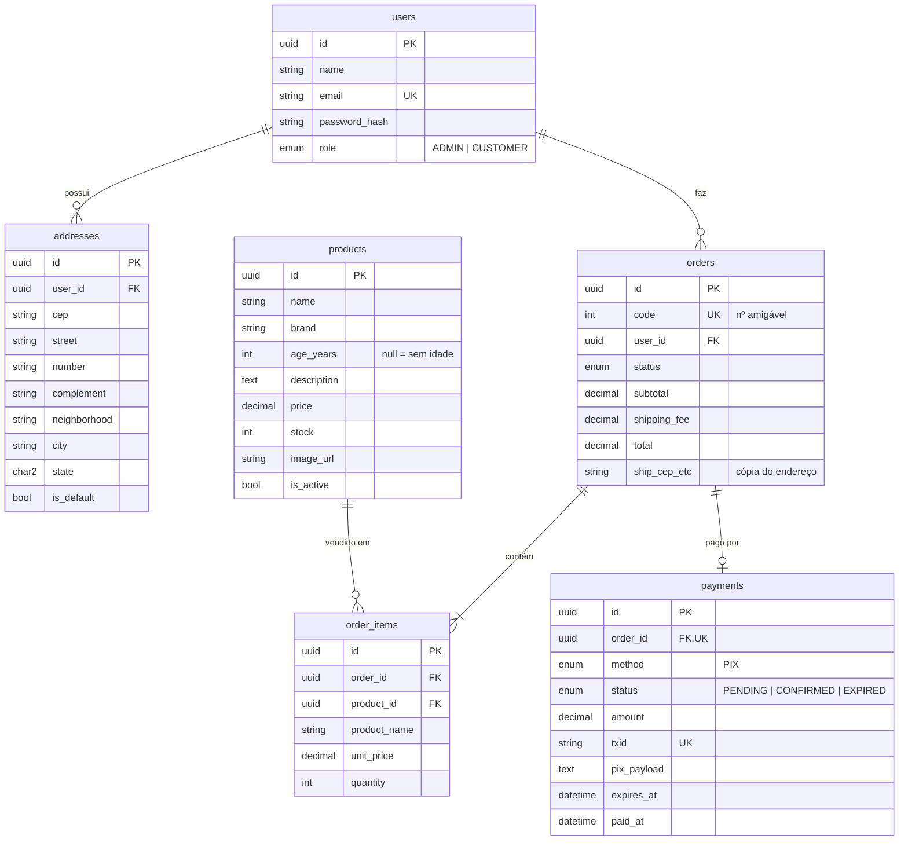

# 🥃 Whisky Pub

E-commerce full stack para venda de whisky, com painel administrativo (catálogo/estoque e pedidos) e área do cliente (catálogo, carrinho, endereço de entrega e pagamento via PIX).

> **Status:** Etapa 1 — banco de dados e backend. O frontend (React) vem na Etapa 2.

## Arquitetura

```
┌──────────────────────┐   HTTPS/JSON + JWT   ┌──────────────────────┐   Prisma ORM   ┌──────────────┐
│  Frontend (SPA)      │ ───────────────────▶ │  API REST            │ ─────────────▶ │  PostgreSQL  │
│  React + Vite        │                      │  Node.js + Express 5 │                └──────────────┘
│  React Router        │ ◀─────────────────── │  Zod (validação)     │
│  TanStack Query      │    imagens /uploads  │  JWT + bcrypt (auth) │──▶ QR Code PIX (BR Code)
│  Tailwind CSS        │                      │  Multer (upload)     │
└──────────────────────┘                      └──────────────────────┘
```

| Camada | Tecnologia | Por quê |
| --- | --- | --- |
| Banco | **PostgreSQL 16** | Relacional, transações sólidas (essencial para estoque e pedidos) |
| ORM | **Prisma** | Esquema declarativo, migrations versionadas, tipagem e consultas seguras |
| API | **Node.js 20+ / Express 5** | Simples, maduro, erros assíncronos tratados nativamente |
| Validação | **Zod** | Mesmas regras podem ser reaproveitadas no frontend |
| Autenticação | **JWT + bcrypt** | Stateless; níveis de acesso `ADMIN` e `CUSTOMER` no token |
| Pagamento | **PIX BR Code** | Payload "copia e cola" real (padrão BCB) + QR Code; confirmação simulada |
| Frontend | **React + Vite + Tailwind** | Etapa 2 |

### Decisões importantes

- **Estoque à prova de corrida:** no checkout a baixa é condicional (`stock >= quantidade`) dentro de uma transação — dois clientes não conseguem comprar a última garrafa ao mesmo tempo.
- **Preço sempre do servidor:** o carrinho fica no navegador, mas o backend recalcula preços, frete e total. O cliente nunca define o valor do pedido.
- **Histórico preservado:** o pedido guarda cópia do nome/preço dos itens e do endereço. Apagar um whisky que já foi vendido apenas o desativa do catálogo.
- **PIX com validade:** cada cobrança expira (padrão 30 min). Pedidos vencidos são cancelados automaticamente e o estoque volta.
- **Maioridade:** o cadastro exige confirmação de 18+ (venda de bebida alcoólica).

## Estrutura de pastas

```
Whisky-Pub/
├── docker-compose.yml          # PostgreSQL local
├── backend/
│   ├── prisma/
│   │   ├── schema.prisma       # tabelas, enums e relacionamentos
│   │   └── seed.js             # cria o admin e whiskys de exemplo
│   ├── uploads/                # imagens enviadas pelo admin
│   └── src/
│       ├── server.js           # sobe o servidor + rotina de expiração do PIX
│       ├── app.js              # middlewares e montagem das rotas
│       ├── config/env.js       # leitura e validação do .env
│       ├── lib/                # prisma client, erros HTTP
│       ├── middlewares/        # auth (JWT/roles), validação, upload, erros
│       ├── utils/pix.js        # gerador do BR Code PIX (+ testes)
│       └── modules/
│           ├── auth/           # cadastro, login, /me
│           ├── products/       # catálogo público + CRUD admin
│           ├── addresses/      # endereços de entrega do cliente
│           └── orders/         # carrinho/checkout, PIX, pedidos (cliente e admin)
└── frontend/                   # (Etapa 2) React + Vite
    └── src/
        ├── api/                # cliente HTTP (axios) com token
        ├── contexts/           # AuthContext, CartContext
        ├── components/         # layout, cards, rotas protegidas
        └── pages/
            ├── store/          # Catálogo, Produto, Carrinho, Checkout, Pagamento PIX, Meus pedidos
            ├── auth/           # Login, Cadastro
            └── admin/          # Produtos (lista/form), Pedidos
```

## Banco de dados



**Ciclo do pedido:** `PENDING_PAYMENT` → `PAID` → `SHIPPED` → `DELIVERED` (ou `PENDING_PAYMENT` → `CANCELED` por cancelamento/expiração do PIX).

## Endpoints da API

Base: `http://localhost:3333/api` · Rotas protegidas usam `Authorization: Bearer <token>`.

| Método | Rota | Acesso | Descrição |
| --- | --- | --- | --- |
| POST | `/auth/register` | público | Cadastro de cliente `{ name, email, password, isAdult: true }` |
| POST | `/auth/login` | público | Login → `{ token, user }` |
| GET | `/auth/me` | logado | Usuário atual |
| GET | `/products` | público | Catálogo `?search=&brand=&minAge=&maxPrice=&sort=&page=&limit=` |
| GET | `/products/brands` | público | Marcas para filtro |
| GET | `/products/:id` | público | Detalhe do whisky |
| GET/POST/PUT/DELETE | `/addresses[/:id]` | cliente | Endereços de entrega |
| POST | `/orders/quote` | cliente | Confere carrinho: preços, estoque, frete, total |
| POST | `/orders` | cliente | Checkout `{ items: [{productId, quantity}], addressId }` → pedido + PIX |
| GET | `/orders` | cliente | Meus pedidos |
| GET | `/orders/:id` | cliente | Detalhe + QR Code enquanto pendente |
| POST | `/orders/:id/cancel` | cliente | Cancela pedido não pago |
| POST | `/orders/:id/pay/simulate` | cliente | **Simula** o PIX pago (`PIX_SIMULATION=true`) |
| GET | `/admin/products` | admin | Lista incluindo inativos |
| POST | `/admin/products` | admin | Cria whisky (multipart com `image` opcional) |
| PUT | `/admin/products/:id` | admin | Atualiza (parcial) |
| DELETE | `/admin/products/:id` | admin | Apaga (ou desativa, se já vendido) |
| GET | `/admin/orders` | admin | Pedidos `?status=&page=` |
| GET | `/admin/orders/:id` | admin | Detalhe do pedido |
| PATCH | `/admin/orders/:id/status` | admin | Avança status `{ status }` |

## Como rodar

Pré-requisitos: Node.js 20+ e Docker (ou um PostgreSQL local).

```bash
# 1. Banco de dados
docker compose up -d

# 2. Backend
cd backend
cp .env.example .env        # ajuste JWT_SECRET, ADMIN_* e PIX_*
npm install
npx prisma migrate dev --name init   # cria as tabelas
npm run db:seed                      # admin + whiskys de exemplo
npm run dev                          # http://localhost:3333/api/health
```

Testes do gerador PIX: `npm test`

### Teste rápido com curl

```bash
# login do admin
TOKEN=$(curl -s -X POST localhost:3333/api/auth/login -H 'Content-Type: application/json' \
  -d '{"email":"admin@whiskypub.com","password":"TroqueEssaSenha123"}' | node -pe 'JSON.parse(require("fs").readFileSync(0)).token')

# criar whisky com imagem
curl -X POST localhost:3333/api/admin/products -H "Authorization: Bearer $TOKEN" \
  -F name="Talisker 10" -F brand="Talisker" -F ageYears=10 \
  -F description="Single Malt da Ilha de Skye, defumado e apimentado." \
  -F price=379.90 -F stock=12 -F image=@./talisker.jpg
```

### Sobre o PIX

O payload gerado segue o padrão BR Code do Banco Central e pode ser lido por apps de banco reais usando a chave definida em `PIX_KEY`. Como não há integração com um PSP, **a confirmação é simulada** (botão "Já paguei" na tela de pagamento) ou feita manualmente pelo admin. Para produção, troque a simulação por um webhook de um provedor (Mercado Pago, Efí, Asaas etc.) chamando `confirmPayment(orderId)`.

## Roadmap

- [x] Etapa 1 — Banco de dados e API (auth, roles, catálogo, endereços, pedidos, PIX)
- [ ] Etapa 2 — Frontend React: catálogo, carrinho, login, checkout, pagamento, admin
- [ ] Etapa 3 — Deploy, webhook PIX real, e-mails de confirmação
